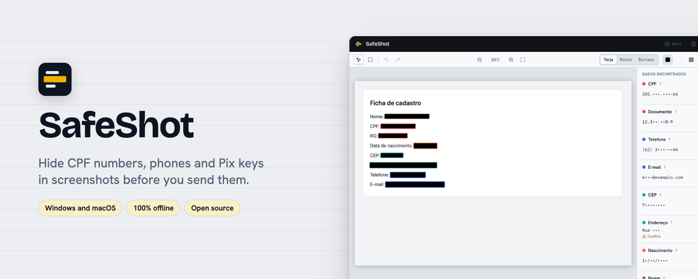
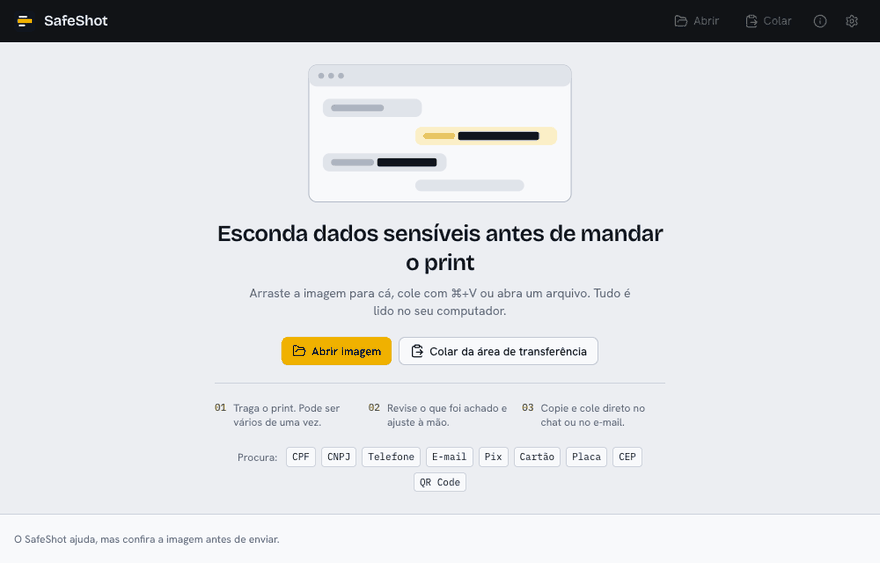
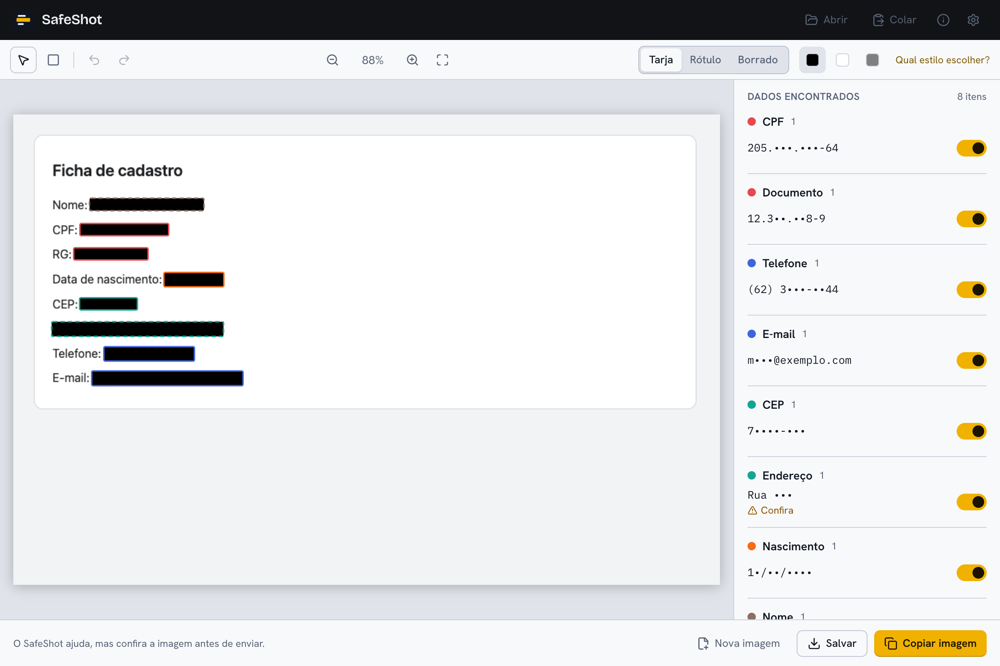
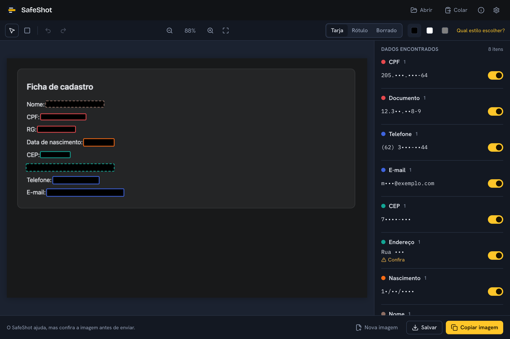

<p align="center">
  
</p>

<p align="center"><a href="README.md">Português</a> · <a href="../../releases">Download</a> · <a href="CONTRIBUTING.md">Contributing</a></p>

<p align="center">   </p>

Hide CPF, phone numbers, e-mail, Pix keys and other sensitive data in screenshots before you share them. Built for Brazilian data: CPF, CNPJ (including the alphanumeric one), RG, Pix key, license plate, CEP, area code.



| Light                                                            | Dark                                                           |
| ---------------------------------------------------------------- | -------------------------------------------------------------- |
|  |  |

## Highlights

- **Finds it for you:** CPF, CNPJ, phone numbers, e-mail, Pix keys, cards, plates, CEP, QR codes and more, reading the image on your computer.
- **Three ways to hide:** a solid bar (the safest), a labelled bar ("CPF", "Phone"…) or a soft smudge that the app reads again and turns into a bar if anything can still be read.
- **A preview that equals the result**, and a pixel check of the exported file before it is handed over.
- **A global shortcut** for "screenshot → shortcut → review → paste in the chat", and a queue for several screenshots.
- **Nothing leaves the computer:** no telemetry and no network.

## Why it exists

Before sending a screenshot I used to open an editor and cross everything out by hand, and sometimes I missed something or used a blur that can be reversed. SafeShot finds the data on its own, including the Brazilian kinds that foreign tools do not know, and exports a copy with solid bars and no metadata.

## Download

Get the installer from the [Releases](../../releases) page:

- **macOS:** `SafeShot_x.y.z_universal.dmg`
- **Windows:** `SafeShot_x.y.z_x64-setup.exe`

## First launch

The app is not signed with a paid certificate because it is a free personal project, so the system shows a warning the first time.

**macOS:** open the `.dmg`, drag SafeShot to Applications and open it. If the system blocks it, go to System Settings → Privacy & Security and click "Open Anyway". If you see "is damaged", run this in Terminal:

```sh
xattr -cr /Applications/SafeShot.app
```

**Windows:** the installer does not ask for administrator rights. If SmartScreen shows up, click "More info" and then "Run anyway".

## How to use

1. Drop one or more screenshots on the window, paste with `Ctrl/⌘+V` or open files (PNG, JPG, WEBP, BMP, GIF; HEIC on macOS). You can also take the screenshot to the clipboard and press the global shortcut (`Ctrl+Alt+Shift+S` on Windows, `⌃⌥⌘S` on macOS): SafeShot opens with the image and starts reading it.
2. Wait for the text reading (a few seconds). Findings show up on the image and in the list, already marked to hide.
3. Review: untick what you want to keep, click any word to hide it, or draw rectangles with `R`.
4. Pick how to hide on the toolbar: **Bar** (one flat colour, the default), **Label** (a bar that says "CPF", "Phone"…) or **Smudge** (a soft patch). The preview on screen is exactly what gets saved.
5. Copy with `Ctrl/⌘+C` or save with `Ctrl/⌘+S`. The saved file is named `<original>-safeshot.png` (or `.jpg` if you pick JPEG in the settings); the original is never changed.
6. Check the image before sending. Holding `Alt` shows the original for comparison.
7. With several files, "Next" moves to the next image in line; each one is reviewed and exported on its own.

## What it does and does not do

It reads the text in the image on your computer (with the system's own reader, Vision on macOS and Windows OCR, and Tesseract in Portuguese and English as a fallback) and looks for CPF, CNPJ, RG and other document numbers found next to a keyword, PIS, CNS, phone numbers with a valid area code, e-mail, CEP, addresses, Pix keys and Pix copy-and-paste codes, cards (Luhn-checked), bank branch and account, license plates, birth dates, labelled names, IPs, known credential formats and URLs with secrets, QR codes and barcodes, plus your own list of terms to always hide. Export uses solid bars (black, white or gray), strips metadata and checks the pixels of the generated image before handing it over.

It does not:

- Guarantee it finds everything. OCR struggles with very small text, noisy backgrounds or decorative fonts, and medium-confidence items show a "Check" tag. The final call is yours.
- Offer ordinary blur or pixelation, on purpose: both spread the pixels of the text and can be partly reversed. "Smudge" is something else: it keeps only four tones per stretch, never the shape of the letters, and the app reads the result again and turns whatever can still be read into a solid bar. For very sensitive data the bar is still the safest choice.
- Read what a QR code says. It covers the whole code instead, and marks it to hide because a QR can hold data like a boarding pass or a Pix payment.
- Make JPEG as precise as PNG: in JPEG the bars grow to 16-pixel blocks so compression leaves no trace of what is underneath. For text, prefer PNG.
- Detect faces or information that is not text.

## Privacy

Nothing leaves your computer: OCR runs locally (system reader or Tesseract, with files bundled in the app) and the webview security policy blocks external connections. No image is written to disk beyond the export you ask for, there is no history, and logs never hold recognized text. To report a detection or privacy problem, see [SECURITY.md](SECURITY.md).

## Run locally

Requirements: Node.js LTS, pnpm, Rust (stable) and, on macOS, the Xcode Command Line Tools.

```sh
pnpm install
pnpm tauri dev
pnpm test
```

## Roadmap

## Contributing

See [CONTRIBUTING.md](CONTRIBUTING.md).

## License

[MIT](LICENSE)
