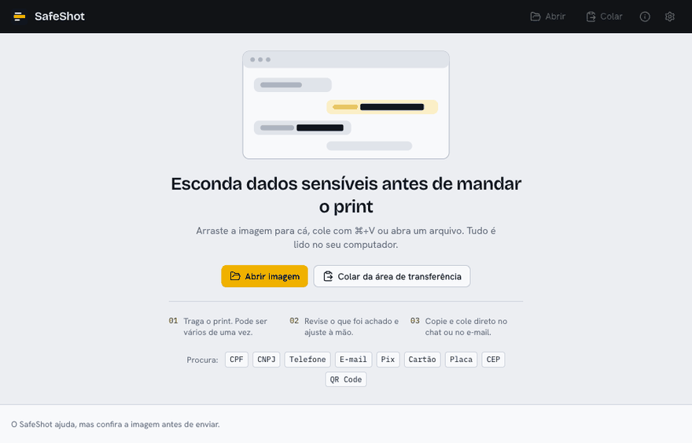
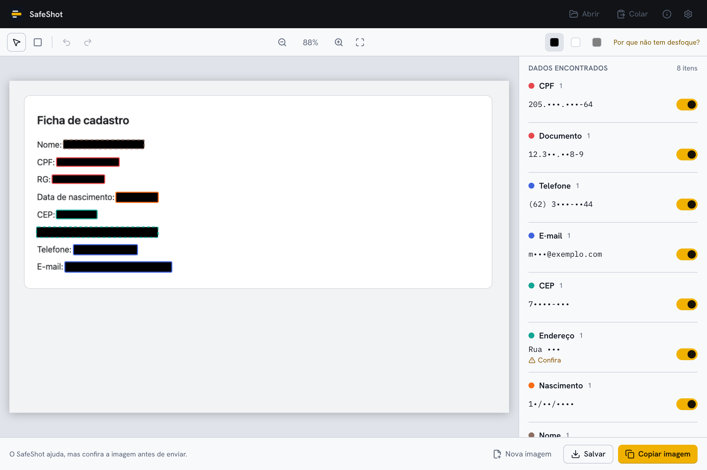
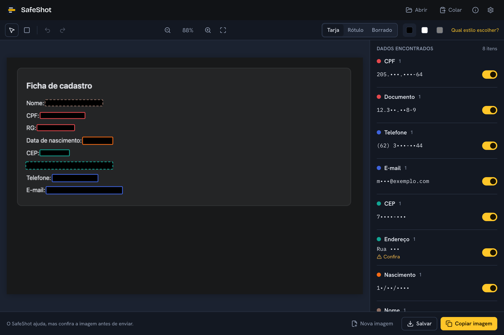

# SafeShot

[English](README.en.md)

Esconda CPF, telefone, e-mail, chave Pix e outros dados sensíveis em prints antes de enviar. Feito para dados brasileiros: CPF, CNPJ (inclusive o alfanumérico), RG, chave Pix, placa, CEP, DDD.

<!-- Grave docs/demo.gif e descomente a linha abaixo. -->
<!--  -->

| Claro                                                                | Escuro                                                               |
| -------------------------------------------------------------------- | -------------------------------------------------------------------- |
|  |  |

## Por que existe

Antes de mandar um print eu abria um editor e riscava tudo na mão, e às vezes esquecia alguma coisa ou usava um desfoque que dá para reverter. O SafeShot acha os dados sozinho, inclusive os brasileiros que ferramentas estrangeiras não conhecem, e exporta uma cópia com tarjas sólidas e sem metadados.

## Download

Baixe o instalador na página de [Releases](../../releases):

- **macOS:** `SafeShot_x.y.z_universal.dmg`
- **Windows:** `SafeShot_x.y.z_x64-setup.exe`

## Primeira abertura

O app não é assinado com certificado pago, porque é um projeto pessoal e gratuito. Por isso o sistema mostra um aviso na primeira vez.

**macOS:** abra o `.dmg`, arraste o SafeShot para Aplicativos e abra. Se o sistema bloquear, vá em Ajustes do Sistema → Privacidade e Segurança e clique em "Abrir Mesmo Assim". Se aparecer a mensagem "está danificado", rode no Terminal:

```sh
xattr -cr /Applications/SafeShot.app
```

**Windows:** o instalador não pede administrador. Se o SmartScreen aparecer, clique em "Mais informações" e depois em "Executar assim mesmo".

## Como usar

1. Arraste um print para a janela, cole com `Ctrl/⌘+V` ou abra um arquivo (PNG, JPG, WEBP, BMP, GIF; HEIC no macOS).
2. Espere a leitura do texto (alguns segundos). Os dados achados aparecem na imagem e na lista, já marcados para ocultar.
3. Revise: desmarque o que quiser manter, clique em qualquer palavra para ocultá-la, ou desenhe retângulos com `R`.
4. Copie com `Ctrl/⌘+C` ou salve com `Ctrl/⌘+S`. O arquivo salvo se chama `<original>-safeshot.png`; o original nunca é alterado.
5. Confira a imagem antes de enviar. Segurar `Alt` mostra o original para comparar.

## O que ele faz e o que não faz

Faz: lê o texto da imagem no seu computador (Tesseract, português e inglês), procura CPF, CNPJ, RG e outros documentos com número de contexto, PIS, CNS, telefone com DDD válido, e-mail, CEP, endereço, chave Pix e Pix copia e cola, cartão (com verificação Luhn), agência e conta, placa, data de nascimento, nome rotulado, IP, credenciais conhecidas e URLs com segredo, além de uma lista sua de termos para sempre ocultar. A exportação usa tarja sólida (preta, branca ou cinza), apaga metadados e confere os pixels da imagem gerada antes de entregá-la.

Não faz:

- Não garante achar tudo. O OCR erra em letra muito pequena, fundo com ruído ou fonte decorativa, e itens com confiança média aparecem como "Confira". A decisão final é sua.
- Não tem desfoque nem pixelização, de propósito: os dois podem ser parcialmente revertidos.
- Não lê QR Code nem código de barras ainda.
- Não detecta rostos nem informações que não estão em texto.

## Privacidade

Nada sai do computador: o OCR roda localmente com arquivos empacotados no app e a política de segurança do webview bloqueia conexões externas. Nenhuma imagem é gravada em disco além da exportação que você pede, não há histórico e os logs não guardam texto reconhecido. Para reportar uma falha de detecção ou de privacidade, veja o [SECURITY.md](SECURITY.md).

## Rodar localmente

Pré-requisitos: Node.js LTS, pnpm, Rust (stable) e, no macOS, as Xcode Command Line Tools.

```sh
pnpm install
pnpm tauri dev
pnpm test
```

## Roadmap

- Atalho global que abre o SafeShot com a imagem da área de transferência.
- Leitura de QR Code e código de barras.
- Exportar em JPEG e fila de várias imagens.
- OCR nativo (Vision no macOS, Windows.Media.Ocr) como alternativa ao Tesseract.
- Menu nativo com Desfazer e Refazer.

## Contribuir

Veja o [CONTRIBUTING.md](CONTRIBUTING.md).

## Licença

[MIT](LICENSE)
