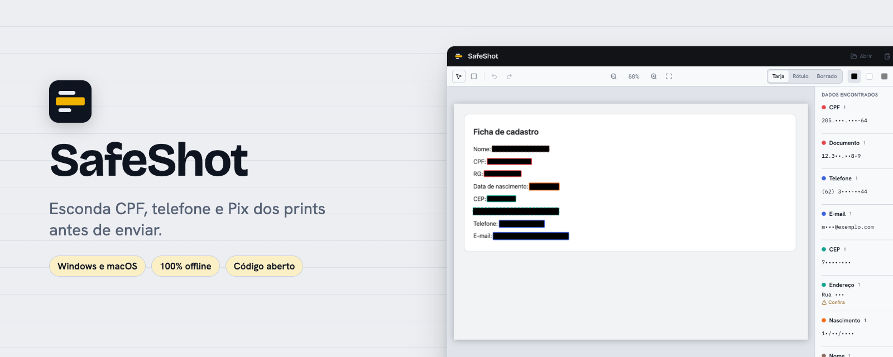

<p align="center">
  
</p>

<p align="center"><a href="README.en.md">English</a> · <a href="../../releases">Download</a></p>

<p align="center">   </p>

Esconda CPF, telefone, e-mail, chave Pix e outros dados sensíveis em prints antes de enviar. Feito para dados brasileiros: CPF, CNPJ (inclusive o alfanumérico), RG, chave Pix, placa, CEP, DDD.


| Claro                                                                | Escuro                                                               |
| -------------------------------------------------------------------- | -------------------------------------------------------------------- |
|  |  |

## Como funciona

<p align="center">
  
</p>

## Destaques

- **Acha sozinho** CPF, CNPJ, telefone, e-mail, Pix, cartão, placa, CEP, QR Code e mais, lendo a imagem no seu computador.
- **Três jeitos de esconder:** tarja sólida (a mais segura), tarja com rótulo ("CPF", "Telefone"…) ou um borrado suave que o app lê de novo e troca por tarja se algo ainda der para ler.
- **Prévia igual ao resultado**, e uma conferência de pixels no arquivo exportado antes de entregá-lo.
- **Atalho global** para o fluxo "print → atalho → revisar → colar no chat", e fila para vários prints.
- **Nada sai do computador:** sem telemetria e sem rede.

## Por que existe

Antes de mandar um print eu abria um editor e riscava tudo na mão, e às vezes esquecia alguma coisa ou usava um desfoque que dá para reverter. O SafeShot acha os dados sozinho, inclusive os brasileiros que ferramentas estrangeiras não conhecem, e exporta uma cópia com tarjas sólidas e sem metadados.

## Instalar pelo Homebrew (macOS)

```sh
brew install --cask yanmfs/tap/safeshot
```

O Homebrew baixa o mesmo instalador da release e coloca o SafeShot em Aplicativos. É a versão universal, para Apple Silicon e Intel. Para atualizar, rode `brew update` e `brew upgrade --cask yanmfs/tap/safeshot`.

Se o macOS pedir confirmação na primeira abertura, veja a seção **Primeira abertura** abaixo. Mais detalhes em [instalação pelo Homebrew](docs/instalacao-homebrew.md).

## Download

Baixe o instalador na página de [Releases](../../releases):

- **macOS:** `SafeShot_x.y.z_universal.dmg`
- **Windows:** `SafeShot_x.y.z_x64-setup.exe`

## Primeira abertura

O app não é assinado com certificado pago, porque é um projeto pessoal e gratuito. Por isso o sistema mostra um aviso na primeira vez.

**macOS:** abra o `.dmg`, arraste o SafeShot para Aplicativos e abra. Se o sistema bloquear, vá em Ajustes do Sistema → Privacidade e Segurança e clique em "Abrir Mesmo Assim". Se aparecer a mensagem "está danificado", rode no Terminal:

```sh
xattr -cr /Applications/SafeShot.app
```

**Windows:** o instalador não pede administrador. Se o SmartScreen aparecer, clique em "Mais informações" e depois em "Executar assim mesmo".

## Como usar

1. Arraste um ou mais prints para a janela, cole com `Ctrl/⌘+V` ou abra arquivos (PNG, JPG, WEBP, BMP, GIF; HEIC no macOS). Também dá para tirar o print para a área de transferência e apertar o atalho global (`Ctrl+Alt+Shift+S` no Windows, `⌃⌥⌘S` no macOS): o SafeShot abre com a imagem e já começa a leitura.
2. Espere a leitura do texto (alguns segundos). Os dados achados aparecem na imagem e na lista, já marcados para ocultar.
3. Revise: desmarque o que quiser manter, clique em qualquer palavra para ocultá-la, ou desenhe retângulos com `R`.
4. Escolha como ocultar na barra: **Tarja** (cor única, o padrão), **Rótulo** (tarja que diz "CPF", "Telefone"…) ou **Borrado** (borrão suave). A prévia na tela é exatamente o que será salvo.
5. Copie com `Ctrl/⌘+C` ou salve com `Ctrl/⌘+S`. O arquivo salvo se chama `<original>-safeshot.png` (ou `.jpg`, se você escolher JPEG nas configurações); o original nunca é alterado.
6. Confira a imagem antes de enviar. Segurar `Alt` mostra o original para comparar.
7. Com vários arquivos, o botão "Próxima" passa para a imagem seguinte da fila; cada uma é revisada e exportada separadamente.

## O que ele faz e o que não faz

Faz: lê o texto da imagem no seu computador (com o leitor do próprio sistema, Vision no macOS e o OCR do Windows, e com o Tesseract em português e inglês como alternativa), procura CPF, CNPJ, RG e outros documentos com número de contexto, PIS, CNS, telefone com DDD válido, e-mail, CEP, endereço, chave Pix e Pix copia e cola, cartão (com verificação Luhn), agência e conta, placa, data de nascimento, nome rotulado, IP, credenciais conhecidas e URLs com segredo, QR Codes e códigos de barras, além de uma lista sua de termos para sempre ocultar. A exportação usa tarja sólida (preta, branca ou cinza), apaga metadados e confere os pixels da imagem gerada antes de entregá-la.

Não faz:

- Não garante achar tudo. O OCR erra em letra muito pequena, fundo com ruído ou fonte decorativa, e itens com confiança média aparecem como "Confira". A decisão final é sua.
- Não tem desfoque comum nem pixelização, de propósito: os dois espalham os pixels do texto e podem ser parcialmente revertidos. O "Borrado" é outra coisa: guarda só quatro tons por trecho, sem a forma das letras, e o app lê o resultado de novo e troca por tarja sólida o que ainda der para ler. Para um dado muito sensível, a tarja continua sendo a escolha mais segura.
- Cobre o QR Code inteiro, mas não diz o que ele contém: um QR pode guardar dados como cartão de embarque ou Pix, por isso o item vem marcado para ocultar.
- No JPEG as tarjas crescem até blocos de 16 pixels, para a compressão não deixar rastro do que está embaixo. Para texto, prefira PNG.
- Não detecta rostos nem informações que não estão em texto.

## Privacidade

Nada sai do computador: o OCR roda localmente (leitor do sistema ou Tesseract, com arquivos empacotados no app) e a política de segurança do webview bloqueia conexões externas. Nenhuma imagem é gravada em disco além da exportação que você pede, não há histórico e os logs não guardam texto reconhecido.

## Rodar localmente

Pré-requisitos: Node.js LTS, pnpm, Rust (stable) e, no macOS, as Xcode Command Line Tools.

```sh
pnpm install
pnpm tauri dev
pnpm test
```

## Roadmap

## Contribuir

Issues e pull requests são bem-vindos.

## Licença

[MIT](LICENSE)
